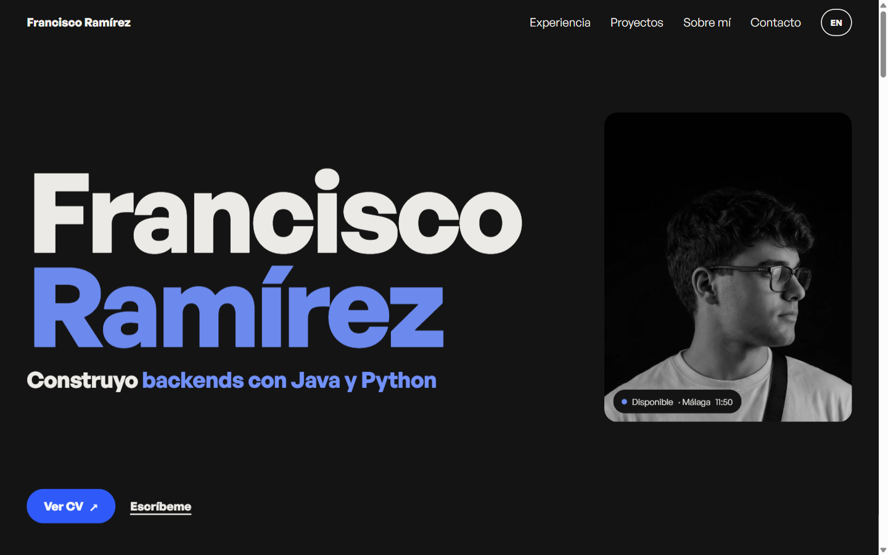

# 💼 Portfolio

> **My personal portfolio: who I am, where I've worked and the projects I've built, in Spanish and English.**

A single-page, bilingual portfolio built with [Astro](https://astro.build/) and Tailwind CSS v4. Static, fast and fully typed: every translation is checked at build time.

[](https://franra18.github.io/portfolio/)




---

## 📑 Table of Contents

- [Features](#-features)
- [Tech Stack](#️-tech-stack)
- [Project Structure](#-project-structure)
- [Getting Started](#-getting-started)
- [Editing Content](#️-editing-content)
- [Deployment](#-deployment)

---

## ✨ Features

- **🌍 Bilingual by route:** Spanish at `/` and English at `/en/`, each a fully static page with its own `hreflang`, canonical URL, Open Graph tags and JSON-LD.
- **🔒 Typed translations:** strings live in one TypeScript dictionary; a missing English key fails `astro check` and the build.
- **🎞️ Scroll storytelling:** the header takes the colour of the section beneath it, company logos trace themselves in, project cards stick and stack as you scroll, and the contact screen is revealed like a blind.
- **🖥️ Interface fragments:** each project shows a small HTML/CSS recreation of its real UI instead of a screenshot.
- **♿ Accessible and calm:** semantic landmarks, visible focus, and every animation switched off under `prefers-reduced-motion`.
- **📄 Downloadable CV** in English and Spanish.
- **🤖 Automated deployment** to GitHub Pages with GitHub Actions.

---

## 🛠️ Tech Stack

| Area | Technology |
|---|---|
| Framework | [Astro](https://astro.build/) (static output, i18n routing) |
| Styling | [Tailwind CSS v4](https://tailwindcss.com/) via the Vite plugin, design tokens in `@theme` |
| Language | TypeScript (strict) |
| Font | [General Sans](https://www.fontshare.com/fonts/general-sans), self-hosted |
| Hosting & CI/CD | GitHub Pages + GitHub Actions |

---

## 📁 Project Structure

```
portfolio/
├── .github/workflows/deploy.yml   # GitHub Pages deployment
├── public/                        # CVs, images, favicon, Open Graph image
├── src/
│   ├── assets/fonts/              # General Sans (woff2)
│   ├── components/
│   │   ├── Header, Hero, Experience, Projects, About, Contact
│   │   ├── logos/                 # Inline SVG logos (animated on scroll)
│   │   └── mocks/                 # HTML/CSS recreations of each project's UI
│   ├── data/                      # Experience and projects
│   ├── i18n/ui.ts                 # Spanish and English strings
│   ├── layouts/Layout.astro       # <head>, SEO and shared scripts
│   ├── pages/                     # / (es) and /en/
│   └── styles/global.css          # Tailwind theme and base styles
└── astro.config.mjs
```

---

## 🚀 Getting Started

```bash
npm install
npm run dev       # http://localhost:4321/portfolio/
npm run build     # type-check + static build into dist/
npm run preview
```

---

## ✏️ Editing Content

- **Text:** edit `src/i18n/ui.ts`. Spanish is the source of truth; English must have the same keys.
- **A new project:** add an entry to `src/data/projects.ts` and, if it needs one, a UI fragment in `src/components/mocks/`.
- **Experience:** `src/data/experience.ts`.

---

## 🌐 Deployment

Every push to `main` builds the site and publishes it to GitHub Pages. To move to a custom domain, set `site` to the new URL and remove `base` in `astro.config.mjs`; every internal path follows `import.meta.env.BASE_URL`.
